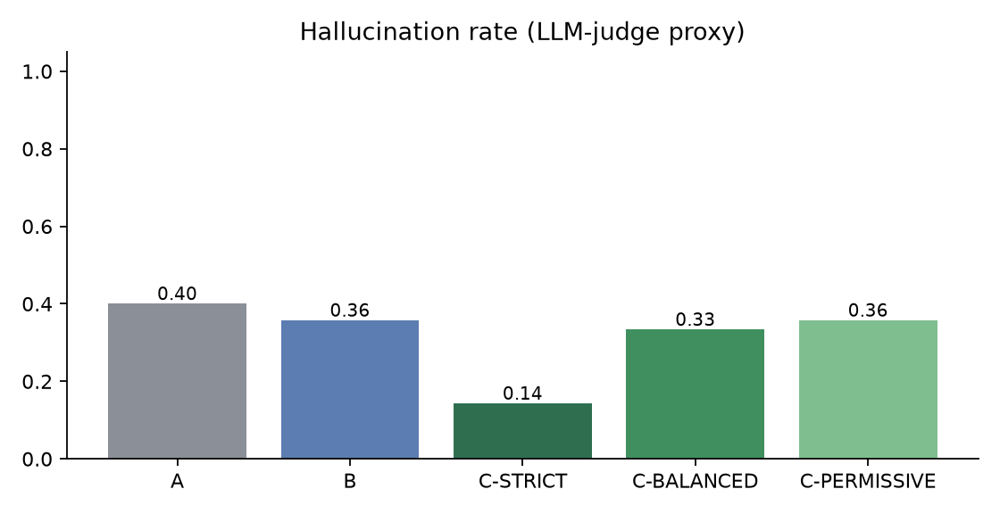
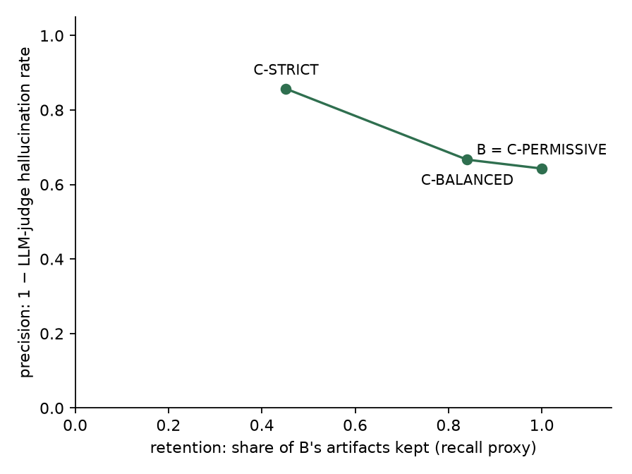
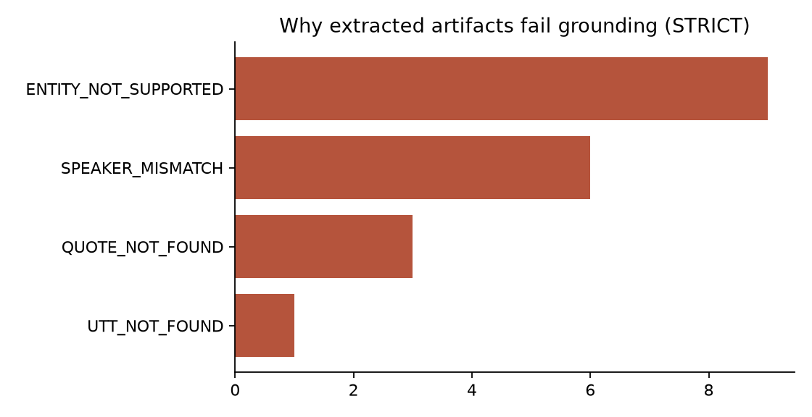

# MinuteAI — project guide: code map and results

This is the in-depth companion to the [README](README.md). It walks through the system in the order a meeting moves through it, links every claim to the code that implements it, and reports what the evaluation found, including where it falls short.

> Code links are permalinks to commit [`9d25489`](https://github.com/Agastaya23/minuteai/tree/9d254892aec0394108231eb8ba5e41cf698c5ba0), so they keep pointing at the right lines as the code evolves.

**Contents:** [1 · The idea](#1--the-idea) · [2 · Life of a meeting](#2--life-of-a-meeting) · [3 · Code map](#3--code-map) · [4 · Main results](#4--main-results) · [5 · What was verified](#5--what-was-verified-end-to-end) · [6 · Reproduce](#6--reproduce) · [7 · Limitations and next steps](#7--limitations-and-next-steps)

---

## 1 · The idea

LLM meeting summarizers are fluent but unaccountable: they produce confident minutes with no way to check a line against what was said. MinuteAI makes accountability structural.

1. **Every extracted claim must cite its evidence.** Each summary sentence, decision, action item and search answer carries `evidence: list[EvidenceSpan]`: utterance IDs, timestamps, the speaker, and a verbatim quote ([`EvidenceSpan`][evidence]).
2. **Citations are verified deterministically, not trusted.** A six-check [grounding validator][validate] tests every citation against the transcript. Artifacts that fail are removed from the minutes, or flagged, depending on the strictness mode. Every removal is logged, and that log is itself a research artifact.
3. **The LLM supplies content, never structure.** IDs, timestamps, speaker labels, chunk and topic boundaries, deduplication, due dates, identities and lifecycle states are all deterministic Python.
4. **Accountability spans meetings.** In a recurring series, commitments are linked across meetings and tracked as fulfilled, slipped, silently dropped or reversed. Every transition cites the moment that caused it.

---

## 2 · Life of a meeting

| # | Status | What happens | Where |
|---|---|---|---|
| 1 | `uploaded` | The UI asks for a presigned S3 URL and uploads the audio straight from the browser. | [`create_meeting`][create_meeting], [upload dialog](frontend/components/upload-dialog.tsx) |
| 2 | | `POST /meetings/{id}/process` persists the next status, then starts a background task. | [`start_processing`][start_processing] |
| 3 | `transcribing` | ffmpeg converts the audio to 16 kHz mono. faster-whisper transcribes it with word timestamps, streamed in ~10 min windows cut at quiet points. pyannote diarizes; each word goes to the speaker turn with maximum overlap, and words are grouped into utterances. The transcript is cached in S3. | [`transcribe_meeting`][transcribe_meeting], [`iter_wav_windows`][iter_wav_windows], [`assign_speakers`][assign_speakers], [`group_utterances`][group_utterances] |
| 4 | `extracting` | Speakers are named from the dialogue. The transcript is chunked at topic shifts. Each chunk gets three structured LLM calls that return claims plus cited `utt_id`s and quotes; timestamps and speakers are attached deterministically. Results are deduplicated across chunk overlaps. | [`extract_meeting`][extract_meeting] |
| 5 | `extracting` | The grounding filter validates every artifact and keeps, flags or drops it. Drops go to `dropped_artifacts.jsonl`. | [`GroundingFilter.apply`][filter_apply] |
| 6 | `ready` | Summary, per-item rows and drops are stored. The search index is updated and the series graph rebuilt. | [`process_meeting`][process_meeting] |
| — | `failed` | Any exception is stored on the meeting, shown in the UI, and can be retried. | [`process_meeting`][process_meeting] |

---

## 3 · Code map

### 3.1 The data contract — `backend/minuteai/models/`

| Code | What it is and why it matters |
|---|---|
| [`Transcript`][transcript] | Utterances with sequential `utt_id`, speaker label/name, start/end and word timings. This is the ground truth everything is validated against. Helpers: `window`, `text_between`, `total_words`. |
| [`EvidenceSpan`][evidence] | `utt_id`, `start_sec`, `end_sec`, `speaker_label`, verbatim `quote` (≤ 200 chars), optional `meeting_id` for cross-meeting evidence. The backbone of the system. |
| [`ActionItem`][action_item] | `owner` is **nullable** and `owner_resolution_method` includes `"unresolved"`, so the system can say "nobody was clearly assigned" instead of guessing. Each artifact also carries `validated` and `flags` set by the filter. |
| [`grounding.py`](backend/minuteai/models/grounding.py), [`graph.py`](backend/minuteai/models/graph.py) | `ValidationResult`, `DroppedArtifact`; `PersonIdentity`, `Commitment`, `Transition`, `DecisionReversal`. |

### 3.2 Storage — `backend/minuteai/storage/` (the only boto3 user)

* [Single-table design + the 8 access patterns][schema], documented in the module docstring. Two examples: action items by owner across meetings via `GSI1PK=OWNER#<name>`, and meetings by status via `STATUS#<status>`.
* [`put_transcript`][put_transcript] keeps the transcript body in S3 and only a pointer in DynamoDB (400 KB item limit). [`put_summary`][put_summary] offloads to S3 above 350 KB and rewrites the per-item `ACTION#` / `DECISION#` rows. [`list_by_owner`][list_by_owner] answers pattern 7.

### 3.3 Transcription — `backend/minuteai/transcribe/`

* [`WhisperBackend`](backend/minuteai/transcribe/whisper_backend.py): `word_timestamps=True` always. [`iter_wav_windows`][iter_wav_windows] feeds Whisper ~10 min windows, cut at the quietest half-second, so memory stays bounded and no PyAV dependency is needed.
* [`assign_speakers`][assign_speakers]: an O(W+T) sweep that gives each word the speaker turn with maximum temporal overlap (nearest turn for gaps). [`group_utterances`][group_utterances] starts a new utterance on a speaker change or a >1.5 s pause. Without diarization it also splits at sentence ends, and it caps utterances at 30 s.
* [`PyannoteDiarizer`][pyannote] (3.1, with per-speaker voice embeddings for identity resolution) and [`parse_aws_transcript`][aws] (the AWS Transcribe adapter, normalized into the same `Transcript`).

### 3.4 Extraction — `backend/minuteai/extract/`

| Code | What it does |
|---|---|
| [`LLMClient`][llmclient] · [`complete_structured`][complete_structured] | **The only place that talks to an LLM.** It requests structured JSON and parses it into a pydantic model; on a validation error it retries once with the error appended. [Backoff][backoff] honours the server's Retry-After, and a [`RateLimiter`][ratelimiter] paces requests per model (free tiers allow ~5/min). Daily quotas fail fast with a clear message. Every call is [logged][llmlog] to `data/llm_calls.jsonl` (tokens, latency, retries) for the cost analysis. |
| [`AnthropicProvider`][anthropic] / [`GeminiProvider`][gemini] | Chosen by `LLM_MODEL` (`claude-*` / `gemini-*`). Gemini 3.x thinks by default, which made calls take minutes; [`_thinking_config`][thinking] sets `low`. |
| [`boundary_scores`][boundary] · [`chunk_transcript`][chunk] · [`segment_topics`][segments] | Topic shift = cosine distance between the mean embeddings of the 4 utterances on each side of a gap, computed in O(n) with prefix sums. Chunks prefer the strongest boundary in the back half of the token budget, overlap by 3 utterances, and **never renumber `utt_id`s**. |
| [`_EVIDENCE_RULES`][rules] · [`ACTION_ITEMS_PROMPT`][action_prompt] | The rules every prompt shares: cite `utt_id`s with verbatim quotes, return empty lists rather than invent, and for owners use `null` + `"unresolved"` when unclear. |
| [`build_evidence`][build_evidence] | Attaches **real** timestamps and speakers to the LLM's cited IDs. Unknown IDs are kept on purpose, so the validator can reject them and the rejection gets logged. |
| [`extract_action_items`][extract_actions] | Turns LLM output into `ActionItem`s; owner labels are mapped to resolved names, and an `"unresolved"` method always clears the owner. [`resolve_relative_date`][dates] turns "by Friday" into a date relative to the meeting date. |
| [`dedup`][dedup] | Greedy near-duplicate merge across overlapping chunks (embedding cosine or fuzzy token match ≥ 0.88). Evidence is unioned, and items with different owners are never merged. |
| [`detect_names`][detect_names] | Deterministic speaker naming. Strong signal: "I'm Priya". Weak signals ("Rahul here", "Thanks Rahul", "Ananya, can you…") count only when corroborated. **Tuned on 60 real AMI meetings**; job titles and fillers are excluded. |
| [`extract_meeting_baseline`][baseline] | Ablation config A: one prompt, no chunking, no evidence. |

### 3.5 Grounding validator and filter — `backend/minuteai/ground/` *(novelty 1)*

[`GroundingValidator.validate`][validate] runs six independently tested checks. Each returns a score in [0, 1] (the fraction of spans or entities that pass), and confidence is their [severity-weighted][weights] mean.

| # | Check | Fails with | Code |
|---|---|---|---|
| 1 | every cited `utt_id` exists | `UTT_NOT_FOUND` | [`check_existence`][c1] |
| 2 | each quote appears in its utterance after [normalization][normalize] (fuzzy partial ratio ≥ 0.85) | `QUOTE_NOT_FOUND` | [`check_quote_fidelity`][c2] |
| 3 | span start/end within the utterance ± 0.5 s | `TIMESTAMP_MISMATCH` | [`check_timestamps`][c3] |
| 4 | named owner/participants are among the cited speakers, and every span's label matches its utterance | `SPEAKER_MISMATCH` | [`check_speakers`][c4] |
| 5 | names, numbers, dates and technical terms ([extracted][entities] by regex + optional spaCy) appear in the cited text; relative dates may resolve to stated dates | `ENTITY_NOT_SUPPORTED` | [`check_entities`][c5] |
| 6 | at least one span | `NO_EVIDENCE` | [`check_non_empty`][c6] |

[`GroundingFilter`][drop_reasons] modes:

* **STRICT:** any failure drops the artifact.
* **BALANCED** (default): drops on checks 1, 2 and 6, and flags the rest.
* **PERMISSIVE:** flags only, drops nothing.

[`apply`][filter_apply] caps each kept artifact's confidence by its grounding confidence. It validates topic-summary sentences shared with the abstract only once, and appends every drop to the research log via [`log_dropped`][log_dropped].

### 3.6 Search — `backend/minuteai/search/`

* [`build_entries`][build_entries]: indexes 5-utterance windows (stride 2) plus every decision and action item. [`SearchIndex`][searchindex] is a FAISS `IndexFlatIP` over normalized MiniLM vectors, persisted to S3 with a JSON sidecar and updated per meeting. A deterministic [`HashingEmbedder`][hashing] keeps everything working without torch.
* [`HybridRetriever.retrieve`][retrieve]: BM25 + dense retrieval fused with reciprocal rank fusion (k = 60). Filters (date, series, participant, type) are applied before ranking.
* [`Answerer.answer`][answer]: the LLM may cite only numbered *utterance* lines, which map back to real `(meeting_id, utt_id)`. The answer runs through the same validator; one that fails is replaced with "couldn't verify" and logged.

### 3.7 Accountability graph — `backend/minuteai/graph/` *(novelty 2)*

| Code | What it does |
|---|---|
| [`resolve_people`][resolve_people] | Per-meeting speaker labels → stable people. Sources: self-introduction, participant list, corroborated direct address, then voice-embedding similarity (≥ 0.75). Pass 1 collects the series' names so they can corroborate weak signals in pass 2. Below confidence 0.5, the speaker stays `unresolved`. |
| [`match_score`][match_score] · [`link_commitments`][link] | Meetings are processed chronologically. An action item links to an open commitment if 0.7·semantic + 0.2·owner + 0.1·entity ≥ 0.6, scanning newest first; different named owners never link. |
| [`LifecycleTracker.observe`][observe] · [`on_recurrence`][recurrence] · [`end_meeting`][end_meeting] | **FULFILLED**: a later utterance about the commitment states completion. **SLIPPED**: re-raised with a new deadline or an explicit delay. **REVERSED**: a later decision cancels it. **SILENTLY_DROPPED**: unmentioned for 2 meetings and past due. A state change also needs ≥ 50% content-word overlap, which stops a stray "done" from closing the wrong commitment. Every transition stores evidence. |
| [`detect_reversals`][reversals] | Pairs a later decision that carries a reversal signal with the most similar earlier decision that has none. Both sides' evidence is kept. |
| [`GraphService.build`][graph_build] | Orchestrates the above and persists the graph (`SERIES#` / `COMMITMENT#` / `TRANSITION#` items). |

### 3.8 API and frontend

* [`process_meeting`][process_meeting]: the state machine, with best-effort post-processing hooks (search indexing, graph rebuild). Routes: [meetings](backend/minuteai/api/routes_meetings.py), [search](backend/minuteai/api/routes_search.py), [graph](backend/minuteai/api/routes_graph.py).
* **The key interaction.** [`useEvidenceTarget`][use_evidence] makes any artifact hoverable and clickable. Hover highlights the cited utterances and [marks the quoted span][mark_quote] in the virtualized transcript, and draws the spans on the [audio timeline][audio]. Click scrolls to the first span and plays from there.
* An [`Owner`][owner] badge renders a distinct dashed "Unassigned" state rather than a blank. The [filtered-artifacts page][dropped_view] shows which checks failed and what the cited utterance actually said. The [series timeline][timeline] makes every cell clickable through to its evidence.

### 3.9 Evaluation harness — `eval/`

* **Loaders:** [`ami.py`](eval/datasets/ami.py) for AMI (gold abstracts, actions and decisions, plus reference words as an "oracle ASR" transcript), [`qmsum.py`](eval/datasets/qmsum.py) for QMSum, and [`samples.py`](eval/datasets/samples.py) for the offline sample set.
* [`run_ablation.run`][run_ablation]: configs A / B / C × {STRICT, BALANCED, PERMISSIVE}. C reuses B's extraction, so **B → C isolates the filter**. All extractions are cached.
* [`stratified_sample`][stratified]: the labelling sheet. [`derived_filter_rates`][derived] scores each C mode on the *same* labelled B statements it keeps (C ⊆ B), so B vs C compares identical items.
* [`retrieved_context`][judge_context]: an LLM-judge **proxy** that judges every statement, whatever its config, against the same retrieved transcript context. It never writes the human rater columns.
* Action-item [`evaluate`][action_eval] reports owner accuracy, abstention and wrong assignment *separately*. [`eval_search`][eval_search] compares BM25 vs dense vs hybrid retrieval.

---

## 4 · Main results

### Setup

| | |
|---|---|
| Data | AMI Meeting Corpus, scenario meetings **ES2002a–d and ES2003a** (2.56 hours), with AMI's reference word transcripts, so ASR errors don't confound extraction |
| Extraction LLM | `gemini-3.5-flash-lite` (free tier), thinking `low`, chunk size 30k tokens |
| Judge LLM | `gemini-3.1-flash-lite`, a different model from the extractor; every statement judged against the same 8 retrieved windows of its meeting |
| Retrieval | QMSum test split: 35 meetings, 244 queries with gold relevant spans, one global index |
| Full outputs | [report.md](docs/results/report.md) · [ablation.csv](docs/results/ablation.csv) · [all_results.json](docs/results/all_results.json) · [judge labels](docs/results/labelling_sheet.autojudge.csv) · [dropped (STRICT)](docs/results/dropped_STRICT.jsonl) |

### 4.1 Headline: does grounding reduce hallucination?

| Config | Artifacts | Retention | Validator pass | Unsupported-entity rate | **Hallucination rate (LLM judge)** | ROUGE-L |
|---|---|---|---|---|---|---|
| A — one prompt, no evidence | 35 | — | 0.00 | 0.180 | **0.400** (n=35) | 0.230 |
| B — chunked, evidence, no filter | 28 | 1.00 | 0.45 | 0.153 | **0.357** (n=28) | 0.220 |
| C-PERMISSIVE | 28 | 1.00 | 0.45 | 0.153 | 0.357 | 0.220 |
| C-BALANCED | 24 | 0.84 | 0.56 | 0.100 | **0.333** (n=24) | 0.161 |
| C-STRICT | 14 | 0.45 | 1.00 | 0.000 | **0.143** (n=14) | 0.092 |



**What this shows**

1. **Evidence-carrying extraction alone helps a little** (A → B: 40% → 36% judged hallucination; 18% → 15% unsupported entities). The real gain is that B's claims become *checkable*.
2. **The filter turns checkability into precision, at a price.** On the same B statements, STRICT cuts the judged hallucination rate from 36% to 14% (−61% relative) and eliminates unsupported entities, but keeps only 45% of the artifacts and halves ROUGE-L. BALANCED keeps 84% and reduces hallucination only modestly (36% → 33%).
3. **The three modes form a precision/recall curve**, not a single operating point. This is the trade-off the strictness setting exposes:



> ⚠️ **These are proxy numbers.** The hallucination rates come from an LLM judge, not people, and the samples are small (n = 14–35 per config). The authoritative figure is the human-labelled rate (`rater_1` / `rater_2` in [labelling_sheet.csv](docs/results/labelling_sheet.csv)); see [§7](#7--limitations-and-next-steps).

### 4.2 Why generations fail grounding (STRICT, AMI)

| Reason | Count | Typical case from the [drop log](docs/results/dropped_STRICT.jsonl) |
|---|---|---|
| `ENTITY_NOT_SUPPORTED` | 9 | Speakers' surnames ("Adam Duguid", "Dave Cochrane") or devices ("LCD", "TV") stated in the minutes but not in the cited lines |
| `SPEAKER_MISMATCH` | 6 | A decision credited to a participant who doesn't speak in any cited utterance |
| `QUOTE_NOT_FOUND` | 3 | The model cites utt 1376 for "Play-Doh … digital pens", but that utterance says neither (match 0.33–0.50) |
| `UTT_NOT_FOUND` | 1 | "Get the minutes up as soon as possible" cites utt 1412, which doesn't exist in ES2002c |



**Two false-positive classes were found by reading this log and then fixed.** AMI spells acronyms as `T_V` and `V_C_R`, and numbers as words ("twenty five Euro"), so correct claims about "TV" or "25 Euro" were being rejected. [`normalize`][normalize] now handles both. This read-the-log → refine-the-check loop is the intended use of the research log.

### 4.3 Action items and summaries vs AMI gold

| Config | Action P | Action R | Action F1 | ROUGE-1 | ROUGE-2 |
|---|---|---|---|---|---|
| A | 0.33 | 0.33 | 0.33 | 0.264 | 0.039 |
| B | 0.15 | 0.20 | 0.17 | 0.244 | 0.058 |
| C-BALANCED | 0.15 | 0.20 | 0.17 | 0.181 | 0.041 |

Action-item agreement with AMI gold is low for every config. AMI's gold actions are abstract and role-based ("The industrial designer will work on the working design"), while the system extracts concrete tasks. Flash-Lite also found few items in sessions b–d. Owner accuracy needs owner labels, which AMI doesn't provide (the `action_owners.csv` hook exists).

### 4.4 Retrieval (QMSum, 244 queries, global index over 35 meetings)

| Retriever | hit@1 | hit@3 | hit@5 | hit@10 | MRR |
|---|---|---|---|---|---|
| BM25 only | **0.316** | 0.414 | 0.475 | 0.541 | 0.380 |
| Dense only (MiniLM) | 0.246 | 0.377 | 0.455 | 0.525 | 0.330 |
| **Hybrid (RRF)** | 0.303 | **0.439** | **0.525** | **0.623** | **0.395** |

Hybrid fusion gives the best MRR and the best recall at 3–10 (hit@10 +8 points over the best single retriever); BM25 alone is marginally better at rank 1. A hit must land in the right meeting *and* overlap QMSum's gold span.

### 4.5 Accountability graph

| Data | Outcome |
|---|---|
| Built-in 3-meeting series (fully labelled) | **7/7 commitments** in the correct lifecycle state (fulfilled ×4, slipped, silently dropped, still committed), plus the one decision reversal, identically with both embedders ([test_graph.py](backend/tests/test_graph.py)) |
| AMI ES2002a–d | 4 commitments, all from session a; 0 links across sessions; 0 reversals ([graph_ES2002.json](docs/results/graph_ES2002.json)) |

The AMI result is a limitation, not a success: participants introduce themselves only in session a, so the speakers in sessions b–d stay unresolved, and Flash-Lite extracted no action items there. Linking people across sessions needs the voice-embedding path, which requires AMI audio plus pyannote.

### 4.6 Cost and latency

25 extraction calls · 484k input / 6.3k output tokens · free tier ($0) · **≈192k tokens and ≈3 min of LLM latency per meeting-hour**. Free-tier quotas (5 requests/minute and 20/day for `gemini-3.5-flash`) shaped the setup: hence Flash-Lite, larger chunks, and the RPM limiter.

---

## 5 · What was verified end to end

* **Tests:** 122 backend + 12 evaluation tests (AWS mocked with moto, LLM with scripted fakes). Each grounding failure mode has its own failing artifact plus one that passes everything ([test_grounding.py](backend/tests/test_grounding.py)).
* **Live LLM:** Gemini on the sample meeting extracted every artifact with correct evidence, kept the unassigned owner unassigned, resolved due dates, and nothing was filtered.
* **Real ASR:** faster-whisper on generated three-voice audio produced 20 utterances matching the 20 reference lines, with monotonic word timestamps.
* **UI in a real browser (desktop + mobile):** upload → S3 → transcribing → extracting; hover evidence highlighting; click-to-seek; failure display and retry; no console errors; no horizontal overflow on mobile.

---

## 6 · Reproduce

```bash
cd backend && uv sync --extra eval --extra retrieval
uv run python ../eval/datasets/ami.py --download                    # AMI annotations
git clone https://github.com/Yale-LILY/QMSum ../eval/data/qmsum      # retrieval eval
# .env: LLM_MODEL=…  LLM_API_KEY=…  LLM_RPM=5 (Gemini free tier)
uv run python ../eval/runners/run_all.py --meetings 5 --model gemini-3.5-flash-lite --chunk-tokens 30000
uv run python ../eval/runners/run_autojudge.py --model gemini-3.1-flash-lite   # LLM-judge proxy
uv run python ../eval/runners/run_all.py --meetings 5 --model gemini-3.5-flash-lite --chunk-tokens 30000  # fold labels in
uv run python ../eval/runners/run_graph.py --series ES2002 --model gemini-3.5-flash-lite --chunk-tokens 30000
```

Everything is cached under `eval/cache/`, so re-runs are free. The offline smoke test is `run_all.py --dataset samples --replay`.

---

## 7 · Limitations and next steps

1. **Human labels — the most important missing piece.** Fill `rater_1` in [labelling_sheet.csv](docs/results/labelling_sheet.csv) (87 statements: supported / unsupported / contradicted). Have a second person fill `rater_2` on ≥ 50 of them, then re-run `run_all.py`. The report then shows the human hallucination rate per config and Cohen's κ, and should replace the LLM-judge numbers in §4.1.
2. **Bigger sample, stronger model.** 5 meetings and Flash-Lite give small n. Running `gemini-3.5-flash` (20 requests/day on the free tier) or a paid model over 15–20 meetings would tighten the estimates.
3. **Diarization and ASR condition.** All results use AMI reference words. Running `--transcript asr` with Whisper + pyannote (`make install-ml`, `HF_TOKEN`) measures the end-to-end system, including ASR noise.
4. **Owner and lifecycle labels.** Add `eval/data/ami/action_owners.csv` for owner accuracy, abstention and wrong assignment. Fill [commitment_labels_ES2002.csv](docs/results/commitment_labels_ES2002.csv) for lifecycle accuracy on real data.
5. **Entity check vs. "insufficient evidence".** Many STRICT drops are true claims whose supporting words sit elsewhere in the meeting (e.g. surnames). That is correct under a cite-your-evidence policy, but it lowers retention. Widening the window to ±1 utterance around each citation for entity containment is the obvious next experiment.

[evidence]: https://github.com/Agastaya23/minuteai/blob/9d254892aec0394108231eb8ba5e41cf698c5ba0/backend/minuteai/models/evidence.py#L16
[transcript]: https://github.com/Agastaya23/minuteai/blob/9d254892aec0394108231eb8ba5e41cf698c5ba0/backend/minuteai/models/transcript.py#L31
[action_item]: https://github.com/Agastaya23/minuteai/blob/9d254892aec0394108231eb8ba5e41cf698c5ba0/backend/minuteai/models/artifacts.py#L35
[schema]: https://github.com/Agastaya23/minuteai/blob/9d254892aec0394108231eb8ba5e41cf698c5ba0/backend/minuteai/storage/schema.py#L1-L30
[put_transcript]: https://github.com/Agastaya23/minuteai/blob/9d254892aec0394108231eb8ba5e41cf698c5ba0/backend/minuteai/storage/repository.py#L154
[put_summary]: https://github.com/Agastaya23/minuteai/blob/9d254892aec0394108231eb8ba5e41cf698c5ba0/backend/minuteai/storage/repository.py#L171
[list_by_owner]: https://github.com/Agastaya23/minuteai/blob/9d254892aec0394108231eb8ba5e41cf698c5ba0/backend/minuteai/storage/repository.py#L212
[create_meeting]: https://github.com/Agastaya23/minuteai/blob/9d254892aec0394108231eb8ba5e41cf698c5ba0/backend/minuteai/api/routes_meetings.py#L38
[start_processing]: https://github.com/Agastaya23/minuteai/blob/9d254892aec0394108231eb8ba5e41cf698c5ba0/backend/minuteai/api/routes_meetings.py#L60
[process_meeting]: https://github.com/Agastaya23/minuteai/blob/9d254892aec0394108231eb8ba5e41cf698c5ba0/backend/minuteai/api/processing.py#L60
[transcribe_meeting]: https://github.com/Agastaya23/minuteai/blob/9d254892aec0394108231eb8ba5e41cf698c5ba0/backend/minuteai/transcribe/pipeline.py#L17
[iter_wav_windows]: https://github.com/Agastaya23/minuteai/blob/9d254892aec0394108231eb8ba5e41cf698c5ba0/backend/minuteai/transcribe/whisper_backend.py#L30
[assign_speakers]: https://github.com/Agastaya23/minuteai/blob/9d254892aec0394108231eb8ba5e41cf698c5ba0/backend/minuteai/transcribe/diarization.py#L36
[group_utterances]: https://github.com/Agastaya23/minuteai/blob/9d254892aec0394108231eb8ba5e41cf698c5ba0/backend/minuteai/transcribe/diarization.py#L84
[pyannote]: https://github.com/Agastaya23/minuteai/blob/9d254892aec0394108231eb8ba5e41cf698c5ba0/backend/minuteai/transcribe/diarization.py#L130
[aws]: https://github.com/Agastaya23/minuteai/blob/9d254892aec0394108231eb8ba5e41cf698c5ba0/backend/minuteai/transcribe/aws_backend.py#L18
[llmclient]: https://github.com/Agastaya23/minuteai/blob/9d254892aec0394108231eb8ba5e41cf698c5ba0/backend/minuteai/extract/llm_client.py#L282
[complete_structured]: https://github.com/Agastaya23/minuteai/blob/9d254892aec0394108231eb8ba5e41cf698c5ba0/backend/minuteai/extract/llm_client.py#L308
[backoff]: https://github.com/Agastaya23/minuteai/blob/9d254892aec0394108231eb8ba5e41cf698c5ba0/backend/minuteai/extract/llm_client.py#L344
[ratelimiter]: https://github.com/Agastaya23/minuteai/blob/9d254892aec0394108231eb8ba5e41cf698c5ba0/backend/minuteai/extract/llm_client.py#L73
[llmlog]: https://github.com/Agastaya23/minuteai/blob/9d254892aec0394108231eb8ba5e41cf698c5ba0/backend/minuteai/extract/llm_client.py#L361
[anthropic]: https://github.com/Agastaya23/minuteai/blob/9d254892aec0394108231eb8ba5e41cf698c5ba0/backend/minuteai/extract/llm_client.py#L131
[gemini]: https://github.com/Agastaya23/minuteai/blob/9d254892aec0394108231eb8ba5e41cf698c5ba0/backend/minuteai/extract/llm_client.py#L184
[thinking]: https://github.com/Agastaya23/minuteai/blob/9d254892aec0394108231eb8ba5e41cf698c5ba0/backend/minuteai/extract/llm_client.py#L241
[boundary]: https://github.com/Agastaya23/minuteai/blob/9d254892aec0394108231eb8ba5e41cf698c5ba0/backend/minuteai/extract/chunker.py#L46
[chunk]: https://github.com/Agastaya23/minuteai/blob/9d254892aec0394108231eb8ba5e41cf698c5ba0/backend/minuteai/extract/chunker.py#L67
[segments]: https://github.com/Agastaya23/minuteai/blob/9d254892aec0394108231eb8ba5e41cf698c5ba0/backend/minuteai/extract/chunker.py#L106
[rules]: https://github.com/Agastaya23/minuteai/blob/9d254892aec0394108231eb8ba5e41cf698c5ba0/backend/minuteai/extract/prompts.py#L14
[action_prompt]: https://github.com/Agastaya23/minuteai/blob/9d254892aec0394108231eb8ba5e41cf698c5ba0/backend/minuteai/extract/prompts.py#L57
[build_evidence]: https://github.com/Agastaya23/minuteai/blob/9d254892aec0394108231eb8ba5e41cf698c5ba0/backend/minuteai/extract/extractor.py#L55
[dedup]: https://github.com/Agastaya23/minuteai/blob/9d254892aec0394108231eb8ba5e41cf698c5ba0/backend/minuteai/extract/extractor.py#L98
[extract_actions]: https://github.com/Agastaya23/minuteai/blob/9d254892aec0394108231eb8ba5e41cf698c5ba0/backend/minuteai/extract/extractor.py#L189
[extract_meeting]: https://github.com/Agastaya23/minuteai/blob/9d254892aec0394108231eb8ba5e41cf698c5ba0/backend/minuteai/extract/extractor.py#L262
[baseline]: https://github.com/Agastaya23/minuteai/blob/9d254892aec0394108231eb8ba5e41cf698c5ba0/backend/minuteai/extract/extractor.py#L329
[dates]: https://github.com/Agastaya23/minuteai/blob/9d254892aec0394108231eb8ba5e41cf698c5ba0/backend/minuteai/extract/dates.py#L32
[detect_names]: https://github.com/Agastaya23/minuteai/blob/9d254892aec0394108231eb8ba5e41cf698c5ba0/backend/minuteai/extract/speakers.py#L67
[validate]: https://github.com/Agastaya23/minuteai/blob/9d254892aec0394108231eb8ba5e41cf698c5ba0/backend/minuteai/ground/validator.py#L368
[weights]: https://github.com/Agastaya23/minuteai/blob/9d254892aec0394108231eb8ba5e41cf698c5ba0/backend/minuteai/ground/validator.py#L45
[normalize]: https://github.com/Agastaya23/minuteai/blob/9d254892aec0394108231eb8ba5e41cf698c5ba0/backend/minuteai/ground/validator.py#L105
[c1]: https://github.com/Agastaya23/minuteai/blob/9d254892aec0394108231eb8ba5e41cf698c5ba0/backend/minuteai/ground/validator.py#L195
[c2]: https://github.com/Agastaya23/minuteai/blob/9d254892aec0394108231eb8ba5e41cf698c5ba0/backend/minuteai/ground/validator.py#L215
[c3]: https://github.com/Agastaya23/minuteai/blob/9d254892aec0394108231eb8ba5e41cf698c5ba0/backend/minuteai/ground/validator.py#L234
[c4]: https://github.com/Agastaya23/minuteai/blob/9d254892aec0394108231eb8ba5e41cf698c5ba0/backend/minuteai/ground/validator.py#L274
[entities]: https://github.com/Agastaya23/minuteai/blob/9d254892aec0394108231eb8ba5e41cf698c5ba0/backend/minuteai/ground/validator.py#L296
[c5]: https://github.com/Agastaya23/minuteai/blob/9d254892aec0394108231eb8ba5e41cf698c5ba0/backend/minuteai/ground/validator.py#L341
[c6]: https://github.com/Agastaya23/minuteai/blob/9d254892aec0394108231eb8ba5e41cf698c5ba0/backend/minuteai/ground/validator.py#L361
[drop_reasons]: https://github.com/Agastaya23/minuteai/blob/9d254892aec0394108231eb8ba5e41cf698c5ba0/backend/minuteai/ground/filter.py#L37
[filter_apply]: https://github.com/Agastaya23/minuteai/blob/9d254892aec0394108231eb8ba5e41cf698c5ba0/backend/minuteai/ground/filter.py#L116
[log_dropped]: https://github.com/Agastaya23/minuteai/blob/9d254892aec0394108231eb8ba5e41cf698c5ba0/backend/minuteai/ground/filter.py#L156
[build_entries]: https://github.com/Agastaya23/minuteai/blob/9d254892aec0394108231eb8ba5e41cf698c5ba0/backend/minuteai/search/index.py#L61
[searchindex]: https://github.com/Agastaya23/minuteai/blob/9d254892aec0394108231eb8ba5e41cf698c5ba0/backend/minuteai/search/index.py#L107
[hashing]: https://github.com/Agastaya23/minuteai/blob/9d254892aec0394108231eb8ba5e41cf698c5ba0/backend/minuteai/search/embedder.py#L46
[retrieve]: https://github.com/Agastaya23/minuteai/blob/9d254892aec0394108231eb8ba5e41cf698c5ba0/backend/minuteai/search/hybrid.py#L64
[answer]: https://github.com/Agastaya23/minuteai/blob/9d254892aec0394108231eb8ba5e41cf698c5ba0/backend/minuteai/search/answerer.py#L76
[resolve_people]: https://github.com/Agastaya23/minuteai/blob/9d254892aec0394108231eb8ba5e41cf698c5ba0/backend/minuteai/graph/entity_resolution.py#L77
[match_score]: https://github.com/Agastaya23/minuteai/blob/9d254892aec0394108231eb8ba5e41cf698c5ba0/backend/minuteai/graph/linker.py#L40
[link]: https://github.com/Agastaya23/minuteai/blob/9d254892aec0394108231eb8ba5e41cf698c5ba0/backend/minuteai/graph/linker.py#L79
[observe]: https://github.com/Agastaya23/minuteai/blob/9d254892aec0394108231eb8ba5e41cf698c5ba0/backend/minuteai/graph/lifecycle.py#L101
[recurrence]: https://github.com/Agastaya23/minuteai/blob/9d254892aec0394108231eb8ba5e41cf698c5ba0/backend/minuteai/graph/lifecycle.py#L176
[end_meeting]: https://github.com/Agastaya23/minuteai/blob/9d254892aec0394108231eb8ba5e41cf698c5ba0/backend/minuteai/graph/lifecycle.py#L202
[reversals]: https://github.com/Agastaya23/minuteai/blob/9d254892aec0394108231eb8ba5e41cf698c5ba0/backend/minuteai/graph/decisions.py#L31
[graph_build]: https://github.com/Agastaya23/minuteai/blob/9d254892aec0394108231eb8ba5e41cf698c5ba0/backend/minuteai/graph/service.py#L45
[use_evidence]: https://github.com/Agastaya23/minuteai/blob/9d254892aec0394108231eb8ba5e41cf698c5ba0/frontend/components/meeting/evidence-context.tsx#L90
[mark_quote]: https://github.com/Agastaya23/minuteai/blob/9d254892aec0394108231eb8ba5e41cf698c5ba0/frontend/components/meeting/transcript-pane.tsx#L12
[audio]: https://github.com/Agastaya23/minuteai/blob/9d254892aec0394108231eb8ba5e41cf698c5ba0/frontend/components/meeting/audio-player.tsx#L17
[owner]: https://github.com/Agastaya23/minuteai/blob/9d254892aec0394108231eb8ba5e41cf698c5ba0/frontend/components/meeting/artifacts-pane.tsx#L127
[dropped_view]: https://github.com/Agastaya23/minuteai/blob/9d254892aec0394108231eb8ba5e41cf698c5ba0/frontend/components/meeting/dropped-view.tsx#L31
[timeline]: https://github.com/Agastaya23/minuteai/blob/9d254892aec0394108231eb8ba5e41cf698c5ba0/frontend/components/series/series-view.tsx#L96
[run_ablation]: https://github.com/Agastaya23/minuteai/blob/9d254892aec0394108231eb8ba5e41cf698c5ba0/eval/runners/run_ablation.py#L131
[stratified]: https://github.com/Agastaya23/minuteai/blob/9d254892aec0394108231eb8ba5e41cf698c5ba0/eval/metrics/grounding.py#L61
[derived]: https://github.com/Agastaya23/minuteai/blob/9d254892aec0394108231eb8ba5e41cf698c5ba0/eval/metrics/grounding.py#L127
[judge_context]: https://github.com/Agastaya23/minuteai/blob/9d254892aec0394108231eb8ba5e41cf698c5ba0/eval/runners/run_autojudge.py#L83
[action_eval]: https://github.com/Agastaya23/minuteai/blob/9d254892aec0394108231eb8ba5e41cf698c5ba0/eval/metrics/action_items.py#L63
[eval_search]: https://github.com/Agastaya23/minuteai/blob/9d254892aec0394108231eb8ba5e41cf698c5ba0/eval/runners/run_all.py#L58
