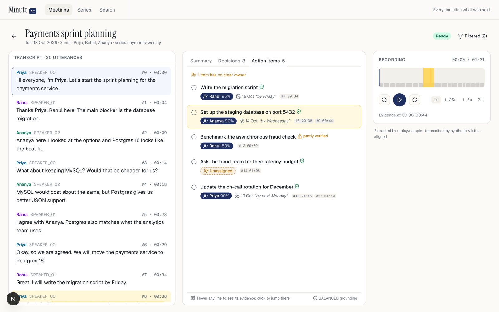
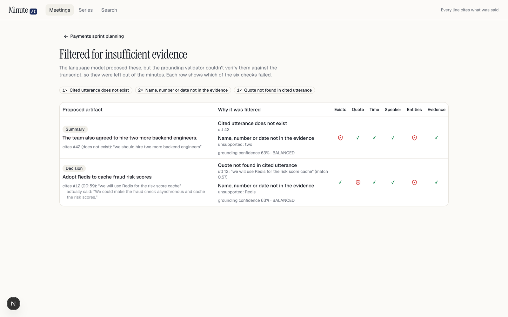
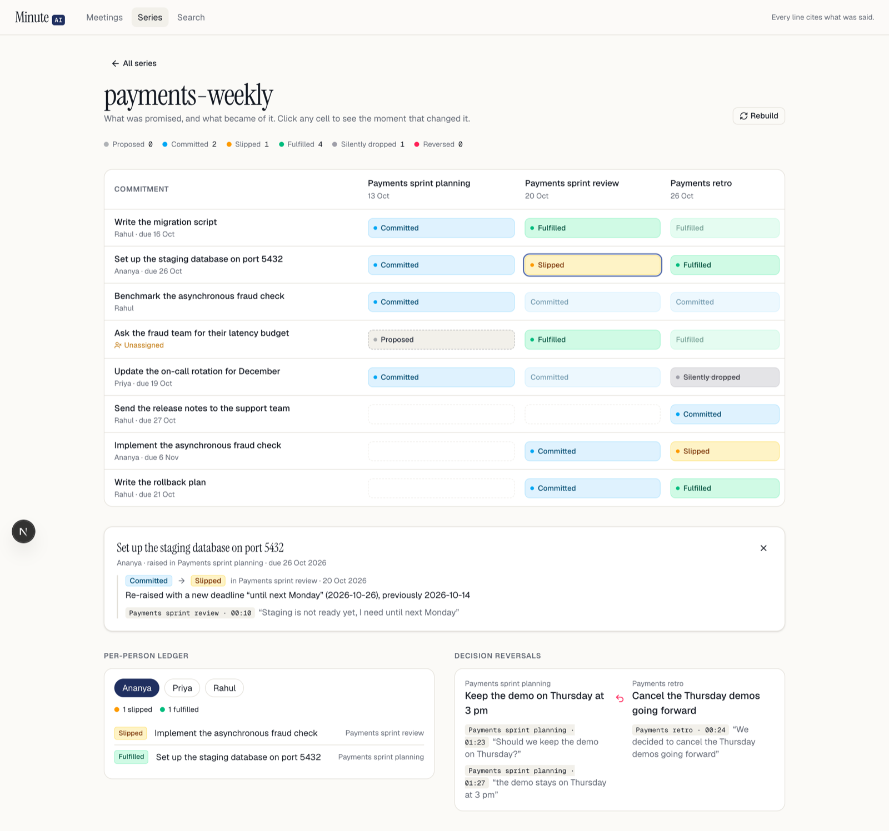

# MinuteAI

**Meeting minutes where every line is backed by what was actually said.**

MinuteAI transcribes a recording with word-level timestamps and speaker diarization, then has an LLM extract a summary, decisions and action items. Each extracted claim must cite the utterances that support it, with a verbatim quote. A deterministic **grounding validator** checks every citation against the transcript. Anything it can't verify is removed from the minutes and logged, never silently shown.

Across a recurring meeting series, a **cross-meeting accountability graph** tracks every commitment: fulfilled, slipped, silently dropped, or reversed. Each change of state links to the moment that caused it.



| Filtered for insufficient evidence | Commitments across a series |
|---|---|
|  |  |

## What's in it

* **Transcription:** faster-whisper with word timestamps, streamed in ~10 min windows, plus pyannote 3.1 diarization (words assigned to the speaker turn with maximum overlap). AWS Transcribe is a drop-in adapter. Transcripts are cached in S3.
* **Evidence-carrying extraction:** topic-boundary chunking that keeps real utterance IDs. Claude or Gemini fill strict JSON schemas. Timestamps, speakers, IDs, merging and due dates are deterministic. Owners can be `null` ("unassigned") instead of guessed.
* **Grounding validator (novelty 1):** six independently tested checks: existence, quote fidelity, timestamp, speaker, entity containment, non-empty. Three strictness modes, and a `dropped_artifacts.jsonl` research log.
* **UI:** hover any sentence, decision or action item to highlight its evidence in a virtualized transcript and on the audio timeline; click to jump and play. A separate page shows what was filtered and which checks failed.
* **Search:** BM25 and MiniLM/FAISS retrieval fused with reciprocal rank fusion. Answers cite meeting and moment, go through the same validator, and say so when the meetings don't cover a question.
* **Accountability graph (novelty 2):** identity resolution across meetings, commitment linking, a lifecycle with evidence on every transition, a decision-reversal log, and per-person ledgers.
* **Evaluation harness:** AMI and QMSum loaders, an ablation (single prompt vs. evidence extraction vs. + grounding in three modes), a labelling sheet for human hallucination rates, Cohen's κ, owner accuracy reported separately from abstention, ROUGE, hit@k/MRR, lifecycle confusion matrix, and cost per meeting-hour.

## Quickstart (no AWS account, no Docker)

```bash
brew install uv node ffmpeg            # or your platform's equivalents
make install                           # backend (uv, Python 3.12) + frontend (npm)
cp .env.example .env
# in .env: DDB_ENDPOINT_URL=http://127.0.0.1:5001  S3_ENDPOINT_URL=http://127.0.0.1:5001
#          AWS_ACCESS_KEY_ID=local  AWS_SECRET_ACCESS_KEY=local  AWS_REGION=us-east-1

make aws-mock        # terminal 1: in-memory S3 + DynamoDB (moto) on :5001
make sample-audio    # optional, macOS: speak the sample meetings with `say`
make seed            # load 3 sample meetings (recorded LLM responses, no API key needed)
make dev-backend     # terminal 2: API on :8080  (docs at /docs)
make dev-frontend    # terminal 3: UI on :3000
```

To process your own recordings, add `LLM_API_KEY` (and optionally `HF_TOKEN` for speaker diarization) to `.env`, run `make install-ml` (or `uv sync --extra asr` for Whisper only), and use **Upload meeting** in the UI.

With real AWS instead: `make ddb-up` (DynamoDB Local in Docker) or `scripts/setup_aws.py`. See [docs/DEPLOYMENT.md](docs/DEPLOYMENT.md).

## Project structure

```
backend/minuteai/
  models/       pydantic contract: Transcript, EvidenceSpan, artifacts, grounding, graph
  storage/      DynamoDB single-table repository + S3 store (the only boto3 users)
  transcribe/   Whisper / AWS Transcribe adapters, diarization merge, pipeline
  extract/      LLMClient (only LLM entry point), chunker, prompts, extractor, speaker naming
  ground/       GroundingValidator (6 checks) + GroundingFilter (3 modes)
  search/       embedder, FAISS index, hybrid BM25+dense retrieval, grounded answerer
  graph/        identity resolution, commitment linker, lifecycle, decision reversals
  api/          FastAPI app, routes, background processing
frontend/       Next.js 15 App Router, Tailwind, shadcn/ui (Base UI), TanStack Query
eval/           datasets/, metrics/, runners/ (run_ablation.py, run_all.py)
scripts/        create_table, setup_aws, transcribe_local, extract_local, seed, make_sample_audio
docs/           ARCHITECTURE.md, DEPLOYMENT.md, BUILD_GUIDE.md
```

## Development

```bash
make test        # ~130 backend + eval tests; AWS mocked with moto, LLM with fakes
make lint        # ruff + eslint
cd backend && uv run python ../scripts/transcribe_local.py meeting.wav     # inspect ASR
cd backend && uv run python ../scripts/extract_local.py --sample demo-sprint-planning --replay --filter
```

## Evaluation

```bash
cd backend && uv sync --extra eval
uv run python ../eval/datasets/ami.py --download                  # AMI annotations
uv run python ../eval/runners/run_ablation.py --meetings 5        # needs LLM_API_KEY
uv run python ../eval/runners/run_all.py --meetings 5             # → eval/results/report.md
```

See [eval/README.md](eval/README.md) for the labelling workflow. The headline number is the human-labelled hallucination rate of **B (evidence, no filter) vs. C (with the grounding filter)**.

More detail on the design: [docs/ARCHITECTURE.md](docs/ARCHITECTURE.md).
