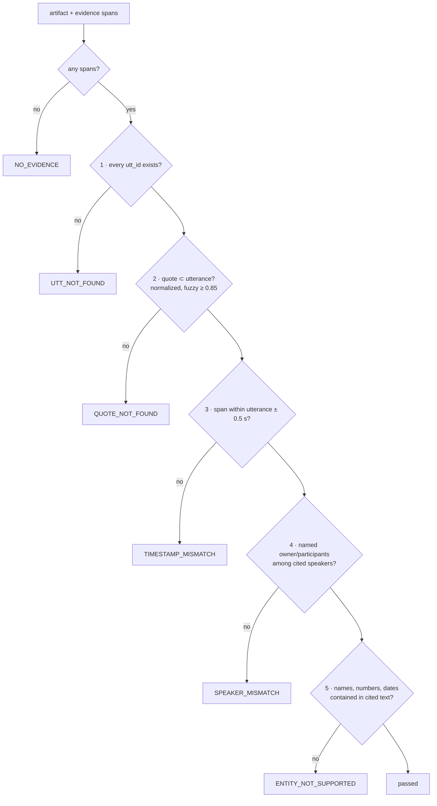

# Architecture

## Components

```mermaid
flowchart LR
    subgraph Browser
        UI["Next.js 15 UI<br/>meetings · detail · filtered · search · series"]
    end
    subgraph API["FastAPI (backend/minuteai/api)"]
        R[routes] --> BG[BackgroundTask<br/>process_meeting]
        R --> SS[SearchService]
        R --> GS[GraphService]
    end
    subgraph Pipeline
        T["transcribe/<br/>faster-whisper + pyannote<br/>│ AWS Transcribe"]
        X["extract/<br/>chunker → LLMClient → extractor"]
        G["ground/<br/>GroundingValidator → GroundingFilter"]
    end
    subgraph Storage["storage/ (only boto3 user)"]
        S3[(S3<br/>audio · transcripts · indexes)]
        DDB[(DynamoDB<br/>single table + GSI1)]
    end
    LLM{{"Claude / Gemini<br/>structured JSON"}}

    UI -- presigned PUT --> S3
    UI -- REST --> R
    BG --> T --> X --> G
    X <--> LLM
    T --> S3
    G --> DDB
    G -. dropped_artifacts.jsonl .-> LOG[(research logs)]
    X -. llm_calls.jsonl .-> LOG
    BG -- on ready --> SS & GS
    SS <--> S3
    GS <--> DDB
```

## Data flow for one meeting

| Step | Status | What happens | Module |
|---|---|---|---|
| 1 | `uploaded` | `POST /meetings` stores the record and returns a presigned S3 PUT URL; the browser uploads the audio directly. | `api/routes_meetings.py`, `storage/s3_store.py` |
| 2 | `transcribing` | `POST /meetings/{id}/process` starts a background task. Audio is converted to 16 kHz mono WAV and streamed to Whisper in ~10 min windows with word timestamps. pyannote speaker turns are merged by maximum overlap, and words are grouped into utterances (new utterance on speaker change or a >1.5 s pause). Transcripts are cached in S3. | `transcribe/` |
| 3 | `extracting` | Speakers are named from the dialogue itself (self-introductions, direct address). The transcript is chunked at topic boundaries (cosine distance between adjacent utterance windows) and each chunk goes through three structured LLM calls. Each returned claim cites `utt_id`s plus a verbatim quote; timestamps and speakers are then attached deterministically. Results are deduplicated across chunk overlaps. | `extract/` |
| 4 | `extracting` | Every artifact goes through the six-check grounding validator. Depending on the strictness mode it is kept, flagged, or dropped, and every drop is logged. | `ground/` |
| 5 | `ready` | The summary, per-item rows and dropped list are stored. Then the search index is updated and the series graph rebuilt. | `storage/`, `search/`, `graph/` |
| — | `failed` | Any exception is persisted on the meeting and shown in the UI with a retry button. | `api/processing.py` |

**Hard rule:** the LLM supplies only *content*. IDs, timestamps, speaker labels, chunk and topic boundaries, merging, due-date resolution and all lifecycle states are deterministic Python.

## Grounding validator: check sequence



Each check returns a score in [0, 1] (the fraction of spans or entities that pass), so confidence degrades smoothly. Confidence is the severity-weighted mean of the six scores (weights: existence 3, quote 3, non-empty 3, entity 2, speaker 1.5, timestamp 1).

| Mode | Drops on | Use |
|---|---|---|
| `STRICT` | any failure | maximum precision |
| `BALANCED` (default) | existence, quote fidelity, non-empty; flags the rest | product default |
| `PERMISSIVE` | nothing (flags only) | maximum recall / analysis |

## DynamoDB single-table design

| Item | PK | SK | GSI1PK | GSI1SK |
|---|---|---|---|---|
| Meeting | `MEETING#<id>` | `META` | `STATUS#<status>` | `<created_at>` |
| Series link | `MEETING#<id>` | `SERIES` | `SERIES#<series>` | `<occurred_at>` |
| Transcript pointer (body in S3) | `MEETING#<id>` | `TRANSCRIPT` | | |
| Summary (S3 if > 350 KB) | `MEETING#<id>` | `SUMMARY` | | |
| Action item | `MEETING#<id>` | `ACTION#<item>` | `OWNER#<normalized name>` | `<occurred_at>#<meeting>#<item>` |
| Decision | `MEETING#<id>` | `DECISION#<id>` | | |
| Dropped artifacts | `MEETING#<id>` | `DROPPED` | | |
| Commitment | `SERIES#<series>` | `COMMITMENT#<id>` | | |
| Transition | `COMMITMENT#<id>` | `TRANSITION#<ts>` | | |
| Reversal | `SERIES#<series>` | `REVERSAL#<id>` | | |
| Person | `SERIES#<series>` | `PERSON#<id>` | `PERSON#<id>` | `SERIES#<series>` |

| # | Access pattern | Operation |
|---|---|---|
| 1 | meeting by id | GetItem `MEETING#id / META` |
| 2 | transcript | GetItem `TRANSCRIPT` → S3 `transcripts/<id>.json` |
| 3 | summary | GetItem `SUMMARY` |
| 4 | action items of a meeting | Query `begins_with(SK, "ACTION#")` |
| 5 | decisions of a meeting | Query `begins_with(SK, "DECISION#")` |
| 6 | meetings in a series, newest first | Query GSI1 `SERIES#<id>`, descending |
| 7 | action items by owner, across meetings | Query GSI1 `OWNER#<name>` |
| 8 | meetings by status | Query GSI1 `STATUS#<status>` |

## Search

* **Index:** 5-utterance windows (stride 2), plus every decision and action item, embedded with `all-MiniLM-L6-v2`. A deterministic hashing embedder is the fallback when sentence-transformers isn't installed. The index is FAISS `IndexFlatIP` over normalized vectors, persisted to `s3://…/indexes/global.faiss` with a JSON sidecar, and updated incrementally per meeting.
* **Retrieval:** BM25 and dense rankings fused with reciprocal rank fusion (k = 60). Filters on date, series, participant, and artifact type are applied before ranking.
* **Answering:** retrieved windows are expanded into numbered *utterance* lines. The LLM may cite only those numbers, which map back to real `(meeting_id, utt_id)` pairs. The answer goes through the same validator, and if it fails, an "I couldn't verify an answer" message replaces it and the attempt is logged.

## Accountability graph

1. **Identity:** per-meeting speaker labels are resolved to people. Sources, strongest first: self-introduction, then the participant list and direct address (weak forms must be corroborated), then voice-embedding similarity. Anything below confidence 0.5 stays `unresolved`.
2. **Linking:** meetings are processed chronologically. Each action item is matched greedily (newest open commitment first) using 0.7 × semantic + 0.2 × owner + 0.1 × entity overlap, with threshold 0.6. Different named owners never link.
3. **Lifecycle:** for each later meeting, utterances similar to an open commitment are checked for completion cues (→ FULFILLED) or delay cues (→ SLIPPED). A re-raised item with a new deadline → SLIPPED. A similar later decision with a reversal signal → REVERSED. No mention for N = 2 meetings and past the due date → SILENTLY_DROPPED. An optional LLM judge covers ambiguous mentions, and its evidence is validated before use.
4. **Decision reversals:** a later decision with a reversal signal is paired with the most similar earlier decision that lacks one, and the evidence for both sides is kept.
