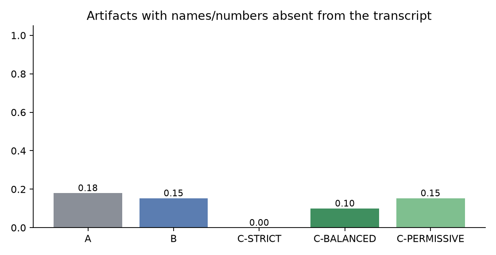
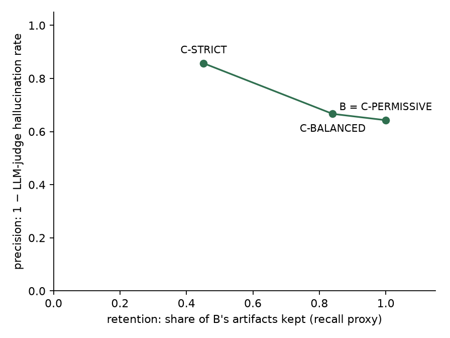
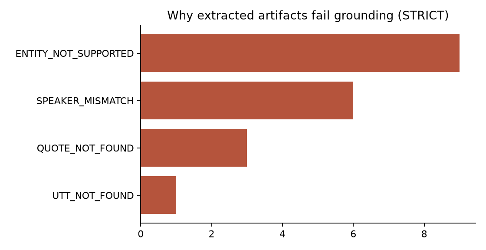

# MinuteAI evaluation report

Generated 2026-10-27 08:41 UTC · dataset **ami** · transcript **reference** · LLM **gemini-3.5-flash-lite** · chunk size 30000 tokens

Meetings: ES2002a, ES2002b, ES2002c, ES2002d, ES2003a

## 1. Ablation: does grounding reduce hallucination?

A = single prompt, no evidence · B = chunked extraction with evidence, no filter · C = B + grounding filter in each strictness mode.

| config | artifacts | retention | validator_pass_rate | unsupported_entity_rate | llm_judge_hallucination_rate | llm_judge_n | hallucination_rate | labelled_n | rougeL | action_f1 |
|---|---|---|---|---|---|---|---|---|---|---|
| A | 35 | 1.000 | 0.000 | 0.180 | 0.400 | 35 | — | 0 | 0.230 | 0.333 |
| B | 28 | 1.000 | 0.452 | 0.153 | 0.357 | 28 | — | 0 | 0.220 | 0.171 |
| C-STRICT | 14 | 0.452 | 1.000 | 0.000 | 0.143 | 14 | — | 0 | 0.092 | 0.133 |
| C-BALANCED | 24 | 0.840 | 0.558 | 0.100 | 0.333 | 24 | — | 0 | 0.161 | 0.171 |
| C-PERMISSIVE | 28 | 1.000 | 0.452 | 0.153 | 0.357 | 28 | — | 0 | 0.220 | 0.171 |

* **hallucination_rate** comes from human labels in `labelling_sheet.csv` (unsupported + contradicted) / labelled; blank until labels are filled in.
* **llm_judge_hallucination_rate** is the same measure labelled automatically by an LLM judge (`run_autojudge.py`): a preliminary proxy, not ground truth.
* C rows are measured on the labelled B statements each mode keeps (C ⊆ B), so B vs C compares identical statements.
* **unsupported_entity_rate** is the automatic proxy: the share of artifacts with a name, number or date that appears nowhere in the transcript.

## 2. Why generations fail grounding

* **STRICT**: ENTITY_NOT_SUPPORTED × 9, SPEAKER_MISMATCH × 6, QUOTE_NOT_FOUND × 3, UTT_NOT_FOUND × 1
* **BALANCED**: QUOTE_NOT_FOUND × 3, ENTITY_NOT_SUPPORTED × 2, UTT_NOT_FOUND × 1, SPEAKER_MISMATCH × 1

## 3. Inter-rater agreement

Fill `rater_1` and `rater_2` on an overlapping subset of `labelling_sheet.csv`.

## 4. Action items and owners

| config | action_precision | action_recall | action_f1 | action_owner_accuracy | action_abstention_rate | action_wrong_assignment_rate |
|---|---|---|---|---|---|---|
| A | 0.333 | 0.333 | 0.333 |  |  |  |
| B | 0.150 | 0.200 | 0.171 |  |  |  |
| C-STRICT | 0.133 | 0.133 | 0.133 |  |  |  |
| C-BALANCED | 0.150 | 0.200 | 0.171 |  |  |  |
| C-PERMISSIVE | 0.150 | 0.200 | 0.171 |  |  |  |

Abstention ("unassigned") and wrong assignment are reported separately: an honest abstention is a different failure from a confident wrong owner.

## 5. Summarization (ROUGE vs gold abstracts)

| config | rouge1 | rouge2 | rougeL |
|---|---|---|---|
| A | 0.264 | 0.039 | 0.230 |
| B | 0.244 | 0.058 | 0.220 |
| C-STRICT | 0.110 | 0.029 | 0.092 |
| C-BALANCED | 0.181 | 0.041 | 0.161 |
| C-PERMISSIVE | 0.244 | 0.058 | 0.220 |

## 6. Retrieval

Global index over all meetings; a hit must be in the right meeting *and* overlap QMSum's gold span.

| retriever | embedder | n | hit@1 | hit@3 | hit@5 | hit@10 | mrr |
|---|---|---|---|---|---|---|---|
| bm25 | all-MiniLM-L6-v2 | 244 | 0.316 | 0.414 | 0.475 | 0.541 | 0.380 |
| dense | all-MiniLM-L6-v2 | 244 | 0.246 | 0.377 | 0.455 | 0.525 | 0.330 |
| hybrid | all-MiniLM-L6-v2 | 244 | 0.303 | 0.439 | 0.525 | 0.623 | 0.395 |

## 7. Commitment lifecycle

Label `eval/data/commitment_labels.csv` (commitment_id,gold_state) to score the lifecycle classifier.

## 8. Cost and latency

25 LLM calls · 484,159 input / 6,295 output tokens · $0.0000 · 466.9s total latency · 0 calls needed a parse retry.

Per meeting-hour: 191,731 tokens · $0.0000 · 182.5s of LLM latency.
